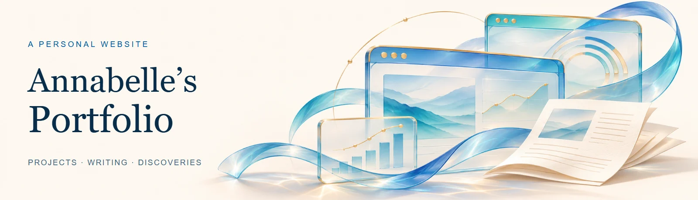
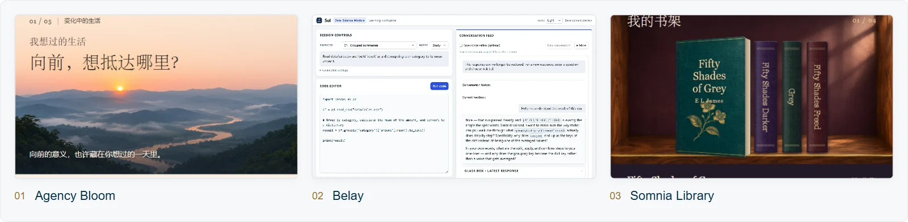
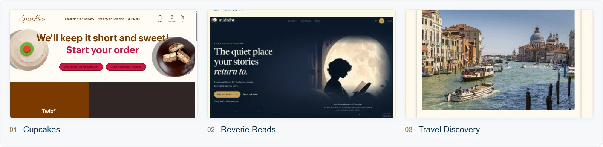
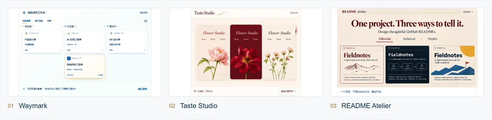
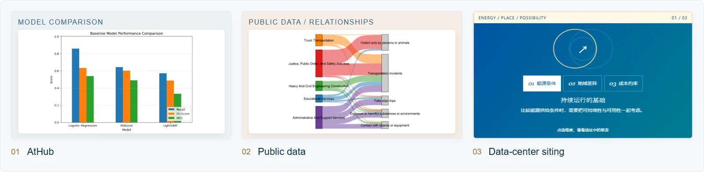
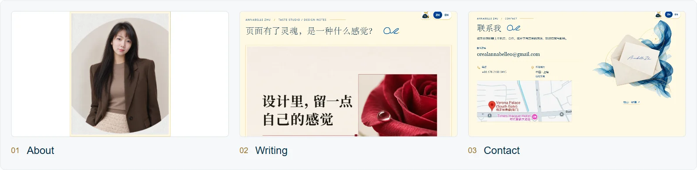
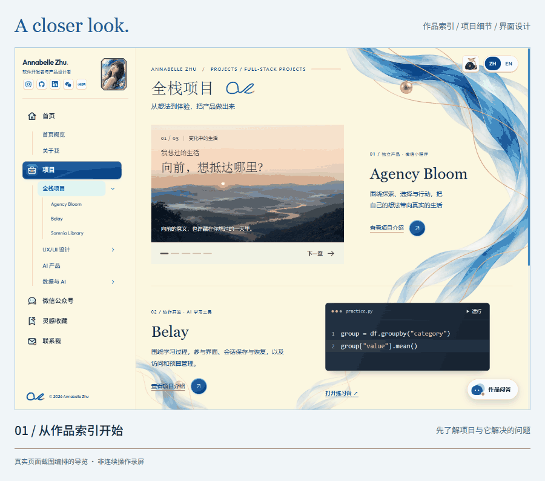

<p align="center">
  <a href="https://annabelle0726.github.io/Annabelle0726/#hero"></a>
</p>

<p align="center">
   <strong>React 19.2.4</strong> &nbsp; · &nbsp;
   <strong>Vite 7.3.6</strong> &nbsp; · &nbsp;
   <strong>JavaScript</strong>
  <br>中文 / English
</p>

<p align="center"><strong>English</strong> · <a href="README.zh-CN.md">简体中文</a></p>

**Annabelle Zhu’s personal website** brings together products I build, ideas I write about, and discoveries I collect. This README is a guide to the site; visit the pages for project stories, interface details, and interactions.

Use the sidebar to move between pages. The main pages are available in Chinese and English; WeChat articles retain their Chinese originals.

[Home](https://annabelle0726.github.io/Annabelle0726/#hero) · [About](https://annabelle0726.github.io/Annabelle0726/#about) · [Projects](https://annabelle0726.github.io/Annabelle0726/#portfolio) · [Writing](https://annabelle0726.github.io/Annabelle0726/#agency-bloom) · [Inspiration](https://annabelle0726.github.io/Annabelle0726/#models) · [Contact](https://annabelle0726.github.io/Annabelle0726/#contact)

## 01 / Full-stack projects

From an idea to a working experience: a WeChat mini program, an AI learning tool, and a reading-management application.

<p align="center">
  <a href="https://annabelle0726.github.io/Annabelle0726/#portfolio"></a>
</p>

| Project | Inside the site | My involvement |
| --- | --- | --- |
| [Agency Bloom](https://annabelle0726.github.io/Annabelle0726/#web-agency-bloom) | A mini program for exploring, choosing and taking action; UI details and a product demo | Independent product conception, interaction, frontend/backend development and iteration |
| [Belay](https://annabelle0726.github.io/Annabelle0726/#web-belay) | AI learning scenarios, the Sol data-science workspace and its feedback flow | Collaboration: interface work, conversation persistence, access and budget management |
| [Somnia Library](https://annabelle0726.github.io/Annabelle0726/#web-somnia) | A personal library, book browsing and reading management | Adapted from Reverie, focusing on interfaces, authentication and mobile navigation |


## 02 / UI/UX design

Interface studies exploring how choosing, browsing and feedback shape everyday interactions.

<p align="center">
  <a href="https://annabelle0726.github.io/Annabelle0726/#XD"></a>
</p>

| Project | Interface & interaction | Context |
| --- | --- | --- |
| [Cupcakes](https://annabelle0726.github.io/Annabelle0726/#XD-cupcakes) | Daily-flavor reveal, flavor calendar and clear state feedback | Web interaction implementation using Sprinkles materials |
| [Reverie Reads / Midniht](https://annabelle0726.github.io/Annabelle0726/#XD-reverie) | A reading flow connecting collecting, discovery and planning | Collaborative support and focused improvements; screens show the wider product |
| [Travel Discovery](https://annabelle0726.github.io/Annabelle0726/#XD-travel) | Destination cards, travel preferences and changing a selection | Course prototype using Marriott Homes & Villas materials; not commissioned by the brand |


## 03 / AI products

Tools and skills that bring AI into job searching, interface design, README communication, and development verification.

<p align="center">
  <a href="https://annabelle0726.github.io/Annabelle0726/#ai-products"></a>
</p>

| Project | Purpose | What is shown |
| --- | --- | --- |
| [Waymark](https://annabelle0726.github.io/Annabelle0726/#waymark-notes) | Jobs, applications and interview preparation; AI reads approved excerpts, and message-driven updates require confirmation | Locally running product; the page includes a concept demo with sample roles |
| [Taste Studio](https://annabelle0726.github.io/Annabelle0726/#taste-studio-notes) | Compare design directions, then refine an interface through preferences and feedback | UI design Skill with a published demo site |
| [README Atelier](https://annabelle0726.github.io/Annabelle0726/#ai-products) | Shape a repository story, cover, illustrations and reading order | README design Skill; a separate project link is pending |
| [Spec to Tested Code](https://annabelle0726.github.io/Annabelle0726/#spec-to-tested-code-notes) | Connect requirements, behavior scenarios and test-driven implementation, with reviewable evidence for completion claims | AI development & verification Skill · SDD / BDD / TDD; [repository](https://github.com/Annabelle0726/spec-to-tested-code) |


## 04 / Data & AI

Analysis, visualization and clear explanations, with the limits of each method and conclusion kept visible.

<p align="center">
  <a href="https://annabelle0726.github.io/Annabelle0726/#services"></a>
</p>

| Project | Focus | Tools |
| --- | --- | --- |
| [AtHub anomaly detection](https://annabelle0726.github.io/Annabelle0726/#data-athub) | Financial time series, model comparison, interpretation and prediction limits | Python · scikit-learn · SHAP · Quarto |
| [Public data visualization](https://annabelle0726.github.io/Annabelle0726/#data-visualization) | Trends and relationships in trade, environmental records and occupational safety | R · dplyr · ggplot2 · ggsankey |
| [Sustainable data-center siting](https://annabelle0726.github.io/Annabelle0726/#data-energy) | Siting tradeoffs across energy, cost and regional constraints | SQL · Tableau · GIS |


## Beyond the projects

The site also holds an introduction to me, an ongoing collection of essays, and tools and discoveries worth keeping.

<p align="center">
  <a href="https://annabelle0726.github.io/Annabelle0726/#about"></a>
</p>

| Page | What you will find |
| --- | --- |
| [Home](https://annabelle0726.github.io/Annabelle0726/#hero) | The site’s blue-and-gold identity, a short introduction and main entry points |
| [About](https://annabelle0726.github.io/Annabelle0726/#about) | An introduction and chapters on curiosity and judgment, writing and expression, and aesthetics and inspiration |
| [WeChat essays](https://annabelle0726.github.io/Annabelle0726/#agency-bloom) | Chinese essays on choice, growth, design and AI practice; continue through the sidebar and article navigation |
| [Inspiration](https://annabelle0726.github.io/Annabelle0726/#models) | Models, tools, skills, [teams and quotes](https://annabelle0726.github.io/Annabelle0726/#quotes), and [reading notes](https://annabelle0726.github.io/Annabelle0726/#notes-felix) |
| [Contact](https://annabelle0726.github.io/Annabelle0726/#contact) | Email, social profiles, location and contact details |


Project cards use cropped page previews and original analysis figures with light layout refinements. The siting card shows the page’s decision framework. The cover is conceptual artwork. Select a category image or project name to explore the full pages.

<details>
<summary>View the page tour and signature animation</summary>

A 12-second tour composed from real page screenshots, not a continuous screen recording.

<p align="center"><picture><source media="(max-width: 600px)" srcset="assets/readme/site-tour-mobile.gif"></picture></p>

[Static preview](assets/readme/site-preview.png) · [Mobile preview](assets/readme/site-preview-mobile.png) · [Signature animation](assets/readme/annabelle-zhu-silk-refined-7s.gif)

</details>

## Run locally

Use **Node.js 20.19+ in the 20.x series, or Node.js 22.12+**.

```bash
git clone https://github.com/Annabelle0726/Annabelle-portfolio.git
cd Annabelle-portfolio
npm install
npm run dev
```

Open the URL printed by Vite.

<details>
<summary>View on a phone on the same network</summary>

For a phone on the same network:

```bash
npm run dev -- --host 0.0.0.0
```

Use the computer's LAN address and the port printed in the terminal.

</details>

<details>
<summary>Build, publish and repository structure</summary>

## Build & publish

```bash
npm run build
npm run preview
```

The build compiles the React site and copies linked static portfolio examples into `dist/`. Deploy the **complete build output**, not the development `index.html`. Relative asset paths support hosting under a subdirectory.

The repository includes a [GitHub Pages workflow](.github/workflows/deploy.yml) triggered by pushes to `main` or a manual run. It installs dependencies, builds the site, and deploys `dist/`.

<details>
<summary><strong>Inside the repository</strong></summary>

```text
src/
  App.jsx               Content views and application shell
  navigation.js         Hash routes and view mapping
  sections/             Portfolio pages and project case studies
  components/           Navigation, artwork, previews and shared UI
  theme.css             Shared color tokens
assets/readme/          Presentation artwork for both READMEs
scripts/copy-static.mjs Static-example packaging
docs/                   Project and visual guidance
```

The main site uses React and Vite. Linked historical examples remain independent static pages. Some external project materials may require access from their original hosting service.

</details>

</details>

## Get in touch

For projects, collaboration, or an interesting idea to share:

**[0realannabelle0@gmail.com](mailto:0realannabelle0@gmail.com)**

[GitHub](https://github.com/Annabelle0726) · [LinkedIn](https://www.linkedin.com/in/huizhu0726/) · [More ways to connect](https://annabelle0726.github.io/Annabelle0726/#contact)

<sub>Third-party brands, project materials, fonts, and icons retain their respective ownership and license terms. Their appearance here does not imply endorsement. See the license and attribution files included with individual assets.</sub>
