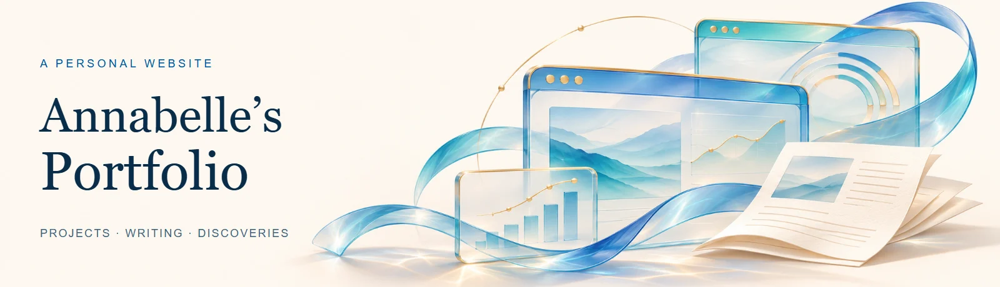
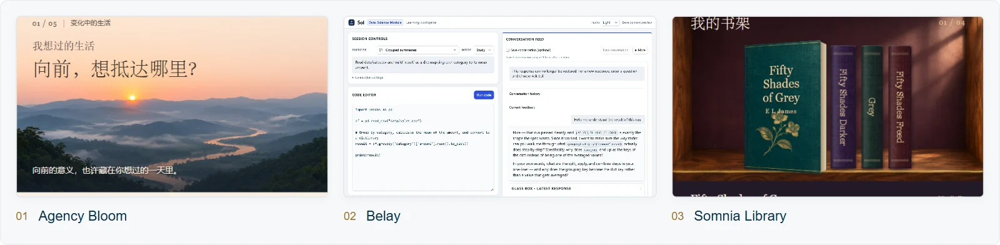
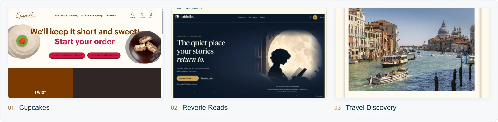
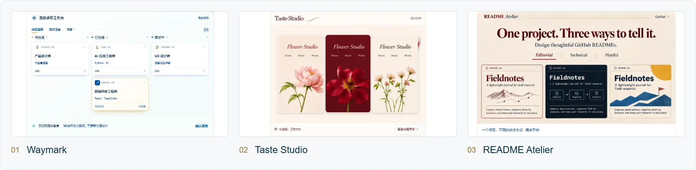
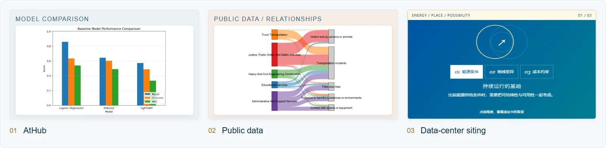
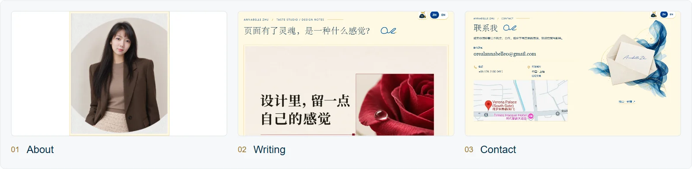
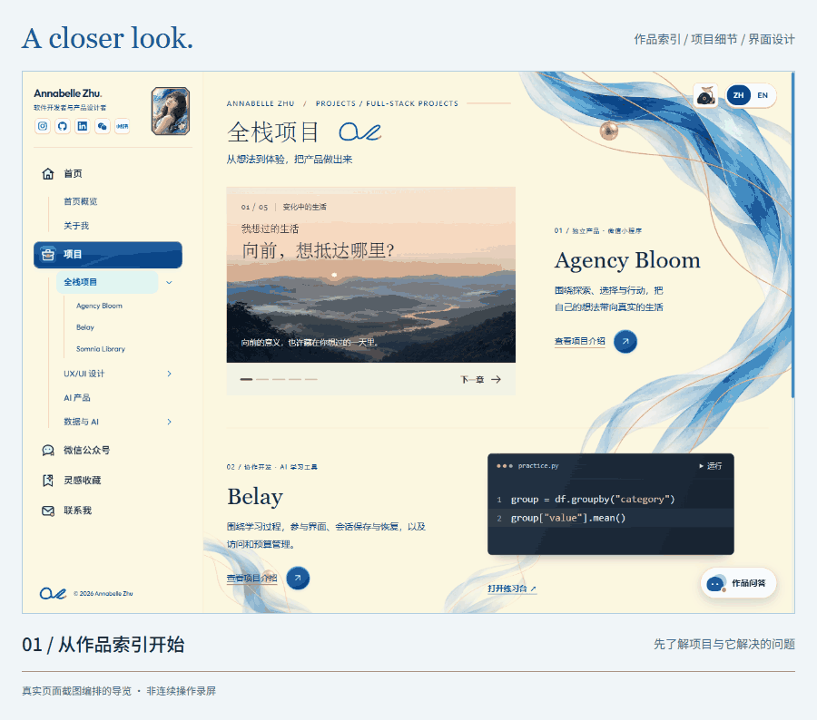

<p align="center">
  <a href="https://annabelle0726.github.io/Annabelle0726/#hero"></a>
</p>

<p align="center"><strong>React 19.2.4 · Vite 7.3.6 · JavaScript</strong><br>中文 / English</p>

<p align="center"><a href="README.md">English</a> · <strong>简体中文</strong></p>

这里是 **Annabelle Zhu 的个人网站**：从做出来的产品，到写下来的思考，再到日常收集的灵感。README 是一份浏览导览，完整的项目过程、页面细节和交互都在网站里。

通过侧栏在不同页面之间切换。主要页面支持中英文，公众号文章保留中文原文。

[首页](https://annabelle0726.github.io/Annabelle0726/#hero) · [About](https://annabelle0726.github.io/Annabelle0726/#about) · [项目](https://annabelle0726.github.io/Annabelle0726/#portfolio) · [公众号](https://annabelle0726.github.io/Annabelle0726/#agency-bloom) · [灵感收藏](https://annabelle0726.github.io/Annabelle0726/#models) · [Contact](https://annabelle0726.github.io/Annabelle0726/#contact)

## 01 / 全栈项目

产品如何从想法变成可以使用的体验：微信小程序、AI 学习工具与阅读管理应用。

<p align="center">
  <a href="https://annabelle0726.github.io/Annabelle0726/#portfolio"></a>
</p>

| 项目 | 网站里可以看到 | 参与方式 |
| --- | --- | --- |
| [Agency Bloom](https://annabelle0726.github.io/Annabelle0726/#web-agency-bloom) | 探索、选择与行动的微信小程序；界面细节与产品演示 | 独立完成产品构思、交互、前后端开发与迭代 |
| [Belay](https://annabelle0726.github.io/Annabelle0726/#web-belay) | AI 学习场景、Sol 数据科学工作区与反馈流程 | 协作开发：界面、会话保存与恢复、访问和预算管理 |
| [Somnia Library](https://annabelle0726.github.io/Annabelle0726/#web-somnia) | 个人书架、书籍浏览与阅读管理体验 | 基于 Reverie 二次开发，聚焦界面、认证与移动导航 |


## 02 / UI/UX 设计

从日常操作出发，观察选择、浏览和反馈如何影响体验。

<p align="center">
  <a href="https://annabelle0726.github.io/Annabelle0726/#XD"></a>
</p>

| 项目 | 界面与交互 | 项目背景 |
| --- | --- | --- |
| [Cupcakes](https://annabelle0726.github.io/Annabelle0726/#XD-cupcakes) | 今日口味揭晓、口味日历与清楚的状态反馈 | 参与网页交互实现；使用 Sprinkles 素材 |
| [Reverie Reads / Midniht](https://annabelle0726.github.io/Annabelle0726/#XD-reverie) | 收藏、发现与阅读计划之间的浏览路径 | 协作支持与局部改进；展示整体产品场景 |
| [Travel Discovery](https://annabelle0726.github.io/Annabelle0726/#XD-travel) | 目的地卡片、旅行偏好与重新选择 | 课程原型；使用 Marriott Homes & Villas 素材，非品牌委托 |


## 03 / AI 产品

围绕求职、界面设计和 README 表达，让 AI 进入具体的工作流程。

<p align="center">
  <a href="https://annabelle0726.github.io/Annabelle0726/#ai-products"></a>
</p>

| 项目 | 用途 | 当前呈现 |
| --- | --- | --- |
| [Waymark](https://annabelle0726.github.io/Annabelle0726/#waymark-notes) | 集中管理岗位、投递进度与面试准备；AI 解读经确认发送的摘录，消息更新需确认 | 本地运行的产品；页面提供示例岗位概念演示 |
| [Taste Studio](https://annabelle0726.github.io/Annabelle0726/#taste-studio-notes) | 先比较多个设计方向，再依据偏好与反馈细化界面 | UI 设计 Skill；演示站已上线 |
| [README Atelier](https://annabelle0726.github.io/Annabelle0726/#ai-products) | 从真实仓库梳理故事，设计封面、配图和阅读顺序 | README 设计 Skill；独立项目链接待补充 |


## 04 / 数据与 AI

用分析、图表与清楚的解释理解问题，也保留方法与结论的边界。

<p align="center">
  <a href="https://annabelle0726.github.io/Annabelle0726/#services"></a>
</p>

| 项目 | 分析内容 | 工具 |
| --- | --- | --- |
| [AtHub 异常检测](https://annabelle0726.github.io/Annabelle0726/#data-athub) | 金融时间序列、模型比较、特征解释与预测边界 | Python · scikit-learn · SHAP · Quarto |
| [公共数据可视化](https://annabelle0726.github.io/Annabelle0726/#data-visualization) | 贸易、环境记录与职业安全的趋势和关系 | R · dplyr · ggplot2 · ggsankey |
| [可持续数据中心选址](https://annabelle0726.github.io/Annabelle0726/#data-energy) | 能源、成本与地域条件之间的选址取舍 | SQL · Tableau · GIS |


## 不止作品：网站里的其他页面

作品之外，还有关于我的介绍、持续更新的文章，以及值得留下的工具与发现。

<p align="center">
  <a href="https://annabelle0726.github.io/Annabelle0726/#about"></a>
</p>

| 页面 | 可以浏览什么 |
| --- | --- |
| [Home / 首页](https://annabelle0726.github.io/Annabelle0726/#hero) | 网站的蓝金视觉、简短介绍和主要入口 |
| [About / 关于我](https://annabelle0726.github.io/Annabelle0726/#about) | 个人介绍，以及好奇与判断、写作与表达、审美与灵感三个章节 |
| [微信公众号](https://annabelle0726.github.io/Annabelle0726/#agency-bloom) | 关于选择、成长、设计与 AI 实践的中文文章；通过侧栏和篇末导航继续阅读 |
| [灵感收藏](https://annabelle0726.github.io/Annabelle0726/#models) | 模型与工具、常用 Skills、[团队与语录](https://annabelle0726.github.io/Annabelle0726/#quotes)，以及[阅读笔记](https://annabelle0726.github.io/Annabelle0726/#notes-felix) |
| [Contact / 联系我](https://annabelle0726.github.io/Annabelle0726/#contact) | 邮箱、社交账号、所在城市与联系方式 |


以上缩略图重新截取自本地运行的作品集，展示实际页面及其中的交互演示或概念示例；封面为概念插画。点击分类图片或项目名称，可进入网站查看完整内容。

<details>
<summary>展开真实页面导览与签名动画</summary>

由实际页面截图编排的 12 秒导览，非连续操作录屏。

<p align="center"><picture><source media="(max-width: 600px)" srcset="assets/readme/site-tour-mobile.gif"></picture></p>

[静态预览](assets/readme/site-preview.png) · [手机预览](assets/readme/site-preview-mobile.png) · [查看签名动画](assets/readme/annabelle-zhu-silk-refined-7s.gif)

</details>

## 本地运行

使用 **Node.js 20.x 中的 20.19 及以上版本，或 Node.js 22.12 及以上版本**。

```bash
git clone https://github.com/Annabelle0726/Annabelle-portfolio.git
cd Annabelle-portfolio
npm install
npm run dev
```

打开 Vite 在终端中显示的地址。

<details>
<summary>在同一网络下用手机查看</summary>

如需用手机查看：

```bash
npm run dev -- --host 0.0.0.0
```

在手机浏览器中使用电脑的局域网 IP 和终端显示的端口。

</details>

<details>
<summary>构建、发布与仓库结构</summary>

## 构建与发布

```bash
npm run build
npm run preview
```

构建会编译 React 主站，并将关联的独立静态作品复制到 `dist/`。部署时上传 **完整构建产物**，不能直接使用开发目录中的 `index.html`。资源采用相对路径，支持部署在子目录下。

仓库已有 [GitHub Pages 发布流程](.github/workflows/deploy.yml)，推送到 `main` 或手动触发时，会安装依赖、构建网站并部署 `dist/`。

<details>
<summary><strong>仓库结构</strong></summary>

```text
src/
  App.jsx               内容视图与应用框架
  navigation.js         Hash 路由与视图映射
  sections/             作品集页面与项目案例
  components/           导航、视觉素材、预览与共享组件
  theme.css             共享颜色变量
assets/readme/          中英文 README 使用的展示素材
scripts/copy-static.mjs 独立静态作品打包
docs/                   项目与视觉规范
```

主站使用 React 与 Vite。关联的历史作品仍保留为独立静态页面，部分外部项目材料可能需要原托管服务的访问权限。

</details>

</details>

## 联系我

欢迎聊聊项目、合作，或分享有意思的想法。

**[0realannabelle0@gmail.com](mailto:0realannabelle0@gmail.com)**

[GitHub](https://github.com/Annabelle0726) · [LinkedIn](https://www.linkedin.com/in/huizhu0726/) · [更多联系方式](https://annabelle0726.github.io/Annabelle0726/#contact)

<sub>第三方品牌、项目素材、字体与图标保留各自的权属及许可条件；在此展示不代表品牌背书。相关说明请参见各素材随附的许可和署名文件。</sub>
